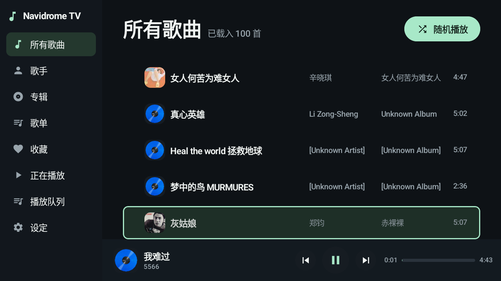
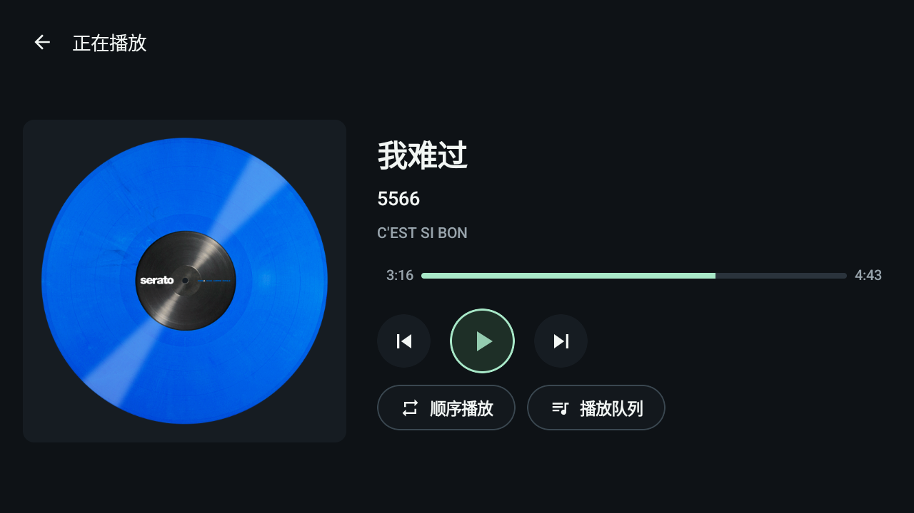
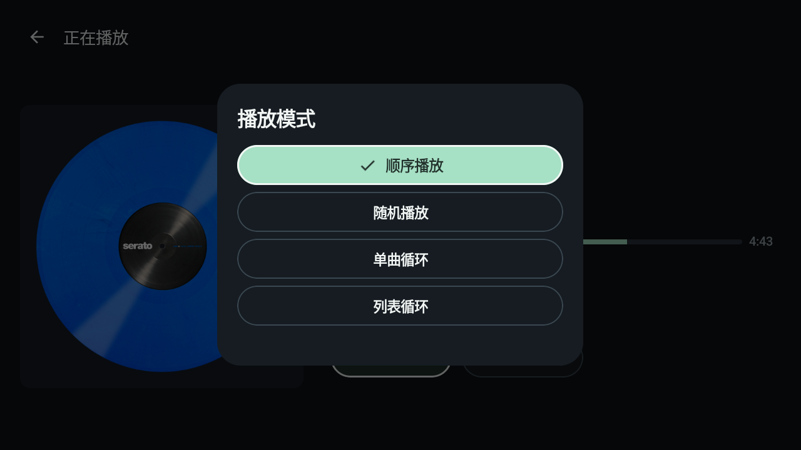

<p align="center">
  
</p>

<h1 align="center">Navidrome TV</h1>

<p align="center"><strong>Your music, in the living room.</strong></p>

<p align="center">
  <a href="#getting-started">Getting started</a> ·
  <a href="docs/getting-started.md">Install and connect</a> ·
  <a href="docs/development.md">Build and test</a> ·
  <a href="https://github.com/yangyao/navidrome-tv/issues">Issues</a> ·
  <a href="README.md">简体中文</a>
</p>

<p align="center"><sub>Guides under <code>docs/</code> are written in Chinese; this page covers the essentials.</sub></p>

Your music is already organised in Navidrome. This turns the TV into another way to listen to it: leave the computer, sit on the sofa, pick a song.

Navidrome TV is a native client for Android TV and Google TV. A phone handles the setup; the TV handles browsing and playback. Everything works with the remote — no typing anywhere in the flow.

**Native Android TV · Phone-based setup · Remote-first · Your own library**



*Running on the Android TV emulator, connected to a personal library.*

## Turn on the TV, pick a song

The home screen lists all your songs. Pick one to start playing, or shuffle the lot. When you'd rather browse the way you remember the collection, go into artists, albums, playlists or favourites.

Albums are one way in. Picking and playing can start straight from the all-songs list; artists and favourites offer a song view too.

Browsing continues during playback. A mini player at the bottom keeps the current track and its controls, and opens the full now-playing screen whenever you want it.

## Setup happens on your phone

On first launch the TV shows a QR code. Scan it with your phone, fill in the Navidrome address, username and password in the browser, and the TV verifies the connection before saving it.

Your phone and the TV need to reach each other on the same network, and the TV needs to reach Navidrome. Credentials stay on the TV and the password is encrypted with the Android Keystore. Reconfiguring and signing out both live in settings.

There's no text search or on-screen keyboard on the TV — finding music happens through songs, artists, albums, playlists and favourites. [Install and connect →](docs/getting-started.md)

## The remote is all you need

The now-playing screen puts focus on play/pause. The D-pad moves, OK confirms; left and right on the progress bar scrub through the track.

Now playing, artist, album, playlist and queue all share the same back entry point in the top left. The remote's back button closes the current panel first, then goes up a level, and puts you back where you were in the list.



## Queue what you want next

Press right on a song to open its action panel: play now, play next, or add to queue. In the queue you can jump to a track or remove one.

Playback modes sit behind a single entry: in order, shuffle, repeat one, repeat all. Reopening the app later, you can also pick up where you left off.



## Your music stays on your server

The app talks to Navidrome over the Subsonic API, reading music and cover art straight from your server, and reporting plays back to it. Quality is either original or compatible; compatible requests MP3 at up to 192 kbps, and whether the server actually transcodes depends on its configuration.

Playback runs in a Media3 service, so it keeps going when you leave the screen. Cover art is cached locally and can be cleared in settings. There are no ads and no analytics SDK.

## Getting started

Current version **0.1.4**, requiring **Android TV / Google TV 8.0 or newer** and a Navidrome server you can reach. The repository ships source only — you build the APK yourself.

1. Have **JDK 17 and Android SDK 34** ready, with `ANDROID_HOME` set or a local `local.properties`.
2. Build from the repository root:

   ```sh
   ./gradlew :app:assembleDebug
   ```

3. Install `app/build/outputs/apk/debug/app-debug.apk` on the TV, or use ADB:

   ```sh
   adb install -r app/build/outputs/apk/debug/app-debug.apk
   ```

4. Open Navidrome TV, scan the QR code with your phone, and start picking songs.

**[Install and connect →](docs/getting-started.md)** · **[Full build and test notes →](docs/development.md)**

## Where it stands

The app is in daily use on a Sony TV, and playback, focus and queue behaviour have been regression-tested on the Android TV emulator. Automated coverage for 0.1.4 is **12 unit tests and 7 on-device integration tests**, covering starting playback from a background thread, jumping around a 1000-song queue, resuming across screens, loop boundaries, caching and service cleanup.

It's still early. Other TVs, networks and very large libraries need more testing; occasional long frames still show up in emulator measurements, so there's no claim that CPU use or smoothness improved across the board. No lyrics, offline downloads or phone-as-remote yet. [Validation scope and known limits →](docs/validation.md)

## Credits and license

An independent client; the TV presentation took design cues from [Chora](https://github.com/CraftWorksMC/Chora). No application code or screenshot assets from it are included here.

Thanks to [Navidrome](https://github.com/navidrome/navidrome) for the music service. This is not an official Navidrome or Sony app. The music and cover art in the screenshots come from a personal server at runtime and are not distributed as app content.

Original code is under the [MIT License](LICENSE); bundled open-source components keep their own licenses — see [third-party notices](THIRD_PARTY_NOTICES.md).
