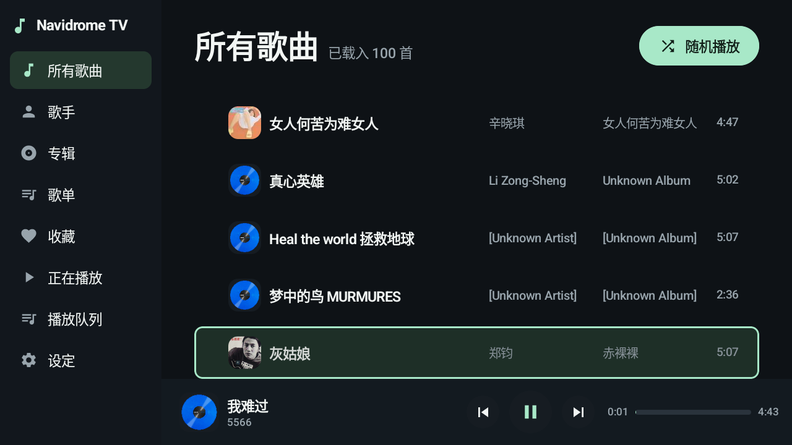
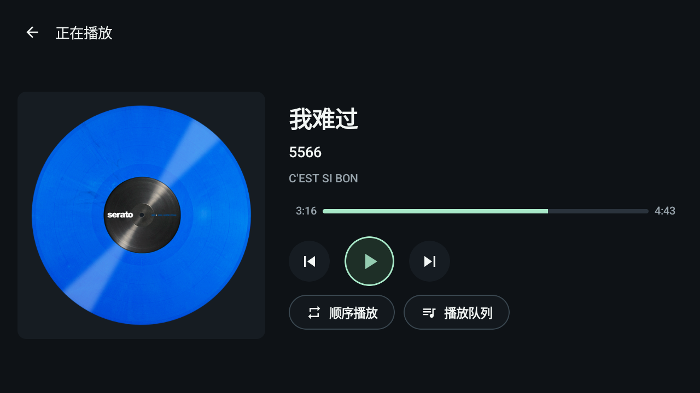
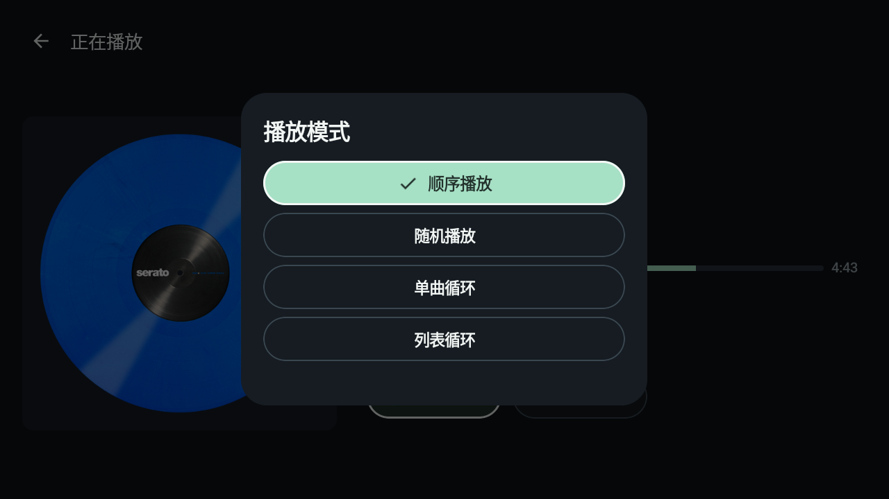

<p align="center">
  
</p>

<h1 align="center">Navidrome TV</h1>

<p align="center"><strong>把自己的音乐，放到客厅里听。</strong></p>

<p align="center">
  <a href="#开始使用">开始使用</a> ·
  <a href="docs/getting-started.md">安装与连接</a> ·
  <a href="docs/development.md">构建与测试</a> ·
  <a href="https://github.com/yangyao/navidrome-tv/issues">反馈问题</a>
</p>

音乐已经整理在自己的 Navidrome 里。打开电视，选一首想听的歌，让客厅也能播放这份音乐收藏。

Navidrome TV 是面向 Android TV / Google TV 的原生音乐客户端。手机扫码完成连接，电视负责浏览和播放。拿起遥控器就能选歌、暂停、切换下一首，整个过程不需要输入文字。

**原生 Android TV · 手机扫码配置 · 遥控器操作 · 自己的音乐库**



*实际运行的 Android TV 模拟器截图，展示已连接的个人音乐库。*

## 打开电视，就能选歌

首页直接显示所有歌曲，可以沿着列表选一首开始播放，也可以随机听听。想按熟悉的方式慢慢找，再进入歌手、专辑、歌单或收藏。

专辑是浏览音乐的一种入口。选歌和播放可以直接从歌曲列表开始，歌手和收藏也提供歌曲视图。

播放时可以继续浏览。底部迷你播放器保留当前歌曲和播放控制，随时进入完整播放页。

## 连接的事情，在手机上完成

首次打开应用，电视显示二维码。用手机扫码，在浏览器里填写 Navidrome 地址、用户名和密码，由电视验证连接后保存。

手机与电视需要在可互相访问的局域网中，电视也需要能连接到 Navidrome。凭证保存在电视本机，密码使用 Android Keystore 加密；重新配置和退出登录都在设置中完成。

电视没有文字搜索和屏幕键盘入口。找歌通过歌曲列表、歌手、专辑、歌单和收藏完成。[安装与连接 →](docs/getting-started.md)

## 遥控器，做好播放这件事

进入播放页，焦点默认落在播放／暂停按钮上。方向键移动，确认执行；在进度条上按左右，可以前后调整播放位置。

播放页、歌手详情、专辑详情、歌单详情和队列共用左上返回入口。遥控器返回键先关闭当前面板，再回到上一页，返回列表时恢复浏览位置。



## 想接着听什么，就放进队列

在歌曲上向右打开操作面板，可以立即播放、下一首播放或加入队列。队列里可以跳到指定歌曲，也可以移除某一首。

播放模式收在一个入口里：顺序播放、随机播放、单曲循环和列表循环。退出后再次打开，也可以选择继续上次的播放。



## 音乐留在自己的服务器

应用通过 Subsonic API 连接 Navidrome，直接从服务器读取音乐和封面，支持播放记录回报。音质可选择原音或相容模式；相容模式会请求 MP3、最高 192 kbps，实际转码取决于服务器配置。

播放使用 Media3 服务，离开当前页面仍可继续。封面有本地缓存，设置里可以清除。应用没有接入广告或分析 SDK。

## 开始使用

当前版本 **0.1.4**，需要 **Android TV / Google TV 8.0 或更新版本**，以及已经运行的 Navidrome 服务器。目前公开仓库提供源码，需要自行构建 APK。

1. 准备 **JDK 17、Android SDK 34**，并配置 `ANDROID_HOME` 或本地 `local.properties`。
2. 在仓库根目录构建：

   ```sh
   ./gradlew :app:assembleDebug
   ```

3. 将 `app/build/outputs/apk/debug/app-debug.apk` 安装到电视；也可通过 ADB 安装：

   ```sh
   adb install -r app/build/outputs/apk/debug/app-debug.apk
   ```

4. 打开 Navidrome TV，手机扫码完成连接，开始选歌。

**[安装与连接指南 →](docs/getting-started.md)** · **[完整构建与测试说明 →](docs/development.md)**

## 现在能做到哪一步

应用已在 Sony 电视上安装使用，并在 Android TV 模拟器上完成播放、焦点和队列回归测试。0.1.4 的自动化验证包含 **12 个单元测试和 7 个设备整合测试**，覆盖后台线程发起播放、1000 首队列跳转、跨页续播、循环边界、缓存和服务清理。

仍处于早期版本。不同电视、网络和大曲库还需要更多验证；模拟器测量中仍有偶发长帧，没有据此宣称整体 CPU 或流畅度已全面改善。当前未提供歌词、离线下载或手机遥控播放。[验证范围与已知限制 →](docs/validation.md)

## 来源与许可证

这是独立实现的客户端，界面设计参考了 [Chora](https://github.com/CraftWorksMC/Chora) 的电视版展示；公开仓库没有引入其应用代码或截图素材。

感谢 [Navidrome](https://github.com/navidrome/navidrome) 提供音乐服务。本项目不是 Navidrome 或 Sony 的官方应用，截图中的音乐信息与封面来自运行时连接的个人服务器，不作为应用内置资源分发。

原创代码按 [MIT 许可证](LICENSE) 发布；所使用的开源组件保留各自许可证，见 [第三方说明](THIRD_PARTY_NOTICES.md)。
